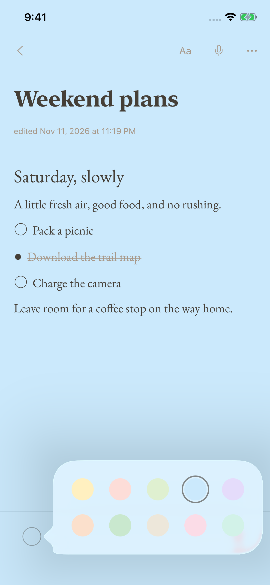

# Braindump

A personal, mobile notes app for iOS. An aesthetic take on the Apple Notes
app for people who want more organization than the default app but less than
Notion. Each page has its own solid pastel background
color, no folders, no nested pages, no block-based editor. Closer to a stack
of colored notecards than a productivity tool.

## Demo


[Watch the walkthrough recording](docs/braindump-demo.mp4).
Captured on an iPhone 17e simulator running iOS 26.5, using sample notes.
The details screen shows the app's real offline fallback, not simulated
AI-generated output. Live on-device generation and voice dictation still
need verification on a physical iPhone.

|                                 |                                          |
| ------------------------------- | ---------------------------------------- |
|  |  |
|  |  |

## On-device AI

Nothing here calls out to a server. Apple's on-device model reads a page and
writes a quick summary, tags it (to-do, idea, project, journal, goal), and
can pull out concrete to-dos from a rambling note and turn them into a
checklist. You can also just talk instead of typing if you'd rather dictate
a note. There's a semantic search too, one that actually understands what
you're looking for instead of just matching substrings. If the model isn't
available or doesn't respond (older OS, unsupported device, or it just
fails), everything quietly falls back to a simpler keyword-based version
instead of breaking, and the app tells you that's what happened instead of
pretending nothing's different.

## Features

- Create, list, open/edit, and delete pages
- Change a page's pastel color
- Rich text: headings/subheading/body styles, bullets, checklists
- Character-level Bold/Italic/Underline formatting
- Soft-delete with a 30-day "recently deleted" recovery flow
- Home screen widget for quick access to a chosen page
- Full VoiceOver accessibility support

## Try it

Not on the App Store or TestFlight yet. Clone it and run it in Xcode
(iOS 17+, with iOS 26+ required for Apple's generative features).

For sample notes in a Debug build, add `-SeedDemoData` to the scheme's
launch arguments. This only seeds an empty store and never replaces
existing notes.

## Development checks

The shared scheme includes focused editor regression tests and an
end-to-end UI workflow covering editing, checklist toggles, colors,
save/relaunch persistence, deletion/undo, and search.

```sh
xcodegen generate
xcodebuild -project Braindump.xcodeproj -scheme Braindump \
  -destination 'platform=iOS Simulator,name=iPhone 17' \
  CODE_SIGN_IDENTITY=- test
```

The redesign has been checked on iPhone 17 and iPhone 17e simulators,
including dark mode and accessibility-sized text. An unsigned iPhone
Release archive also builds successfully. These checks do not replace
physical-device QA or a signed distribution validation.

## TestFlight

Distribution is pending Apple Developer signing and App Store Connect
setup; there is no uploaded beta build yet.

1. Confirm Apple Developer Program enrollment and sign in to Xcode.
2. Select the enrolled team for both the app and widget targets. Register
   their bundle identifiers and enable the shared App Group
   `group.com.athapar.braindump`.
3. Verify editing, the widget, voice permissions/dictation, and on-device
   AI on a physical iPhone.
4. Create the app in App Store Connect, archive a signed Release build,
   then validate and upload it from Xcode Organizer before inviting
   TestFlight testers.
