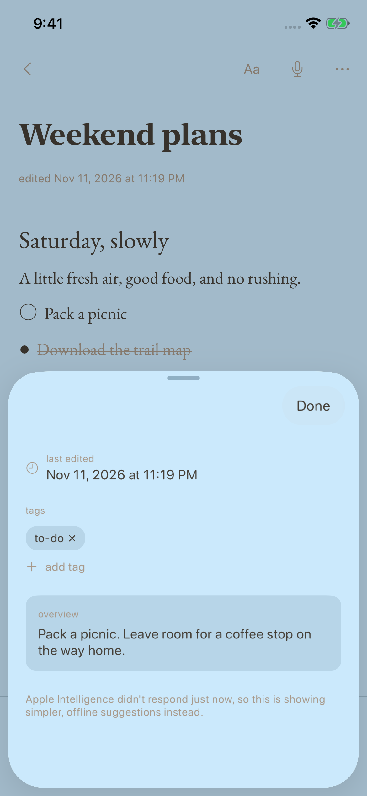
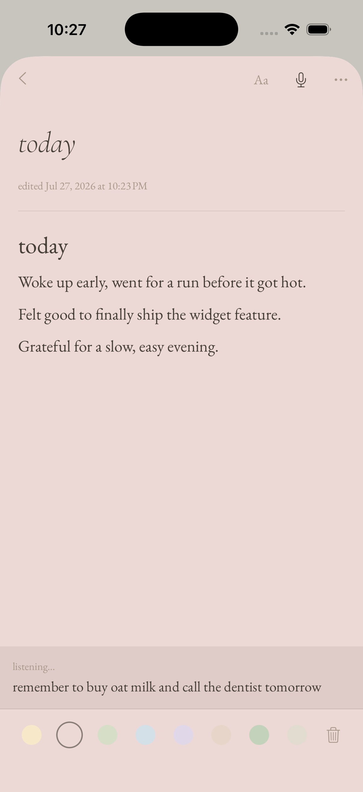

# Braindump

A personal, mobile notes app for iOS. An aesthetic take on the Apple Notes
app for people who want more organization than the default app but less than
Notion. Each page has its own solid pastel background
color, no folders, no nested pages, no block-based editor. Closer to a stack
of colored notecards than a productivity tool.

Not on the App Store yet, so here's what it actually looks like.

|                                 |                                          |
| ------------------------------- | ---------------------------------------- |
|  |  |
|  |  |

## On-device AI

Nothing here calls out to a server. Apple's on-device model reads a page and
writes a quick summary, tags it (to-do, idea, project, journal, goal), and
can pull out concrete to-dos from a rambling note and turn them into a
checklist. You can also just talk instead of typing if you'd rather dictate
a note. There's a semantic search too, one that actually understands what
you're looking for instead of just matching substrings. If the model isn't
available or doesn't respond (older OS, unsupported device, or it just
fails), everything quietly falls back to a simpler keyword-based version
instead of breaking, and the app tells you that's what happened instead of
pretending nothing's different.

## Features

- Create, list, open/edit, and delete pages
- Change a page's pastel color
- Rich text: headings/subheading/body styles, bullets, checklists
- Character-level Bold/Italic/Underline formatting
- Soft-delete with a 30-day "recently deleted" recovery flow
- Home screen widget for quick access to a chosen page
- Full VoiceOver accessibility support

## Try it

Not on the App Store yet, still need to get through Apple Developer
enrollment. Once that's done I'll drop a TestFlight link here. For now,
clone it and run it yourself in Xcode (iOS 17+, though you'll want iOS 26+
to actually see the AI features do anything).
