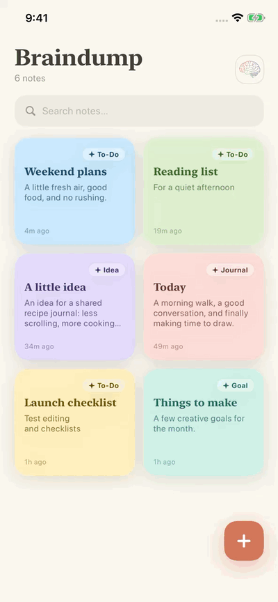
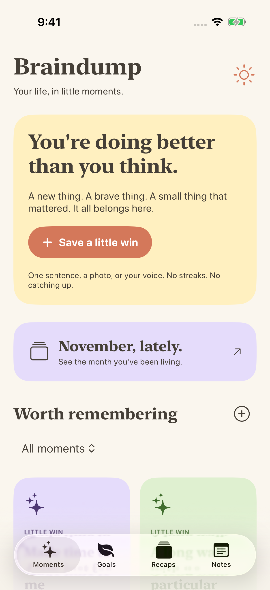
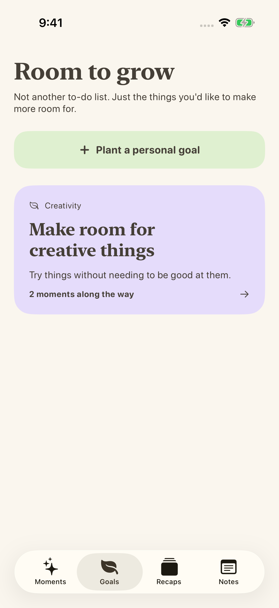
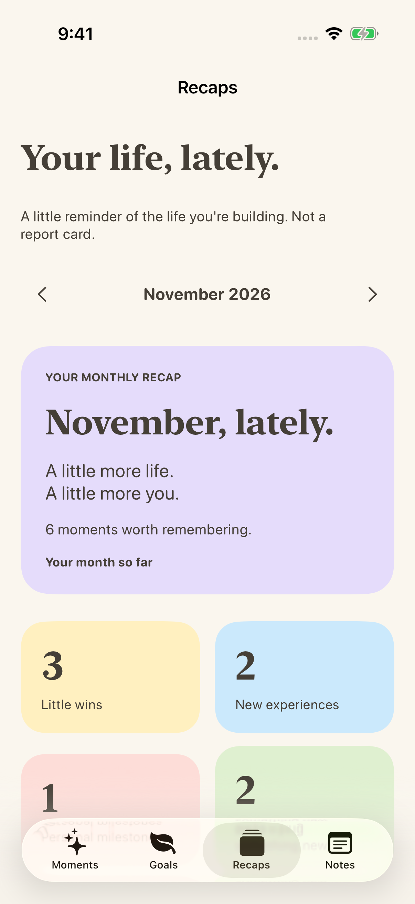
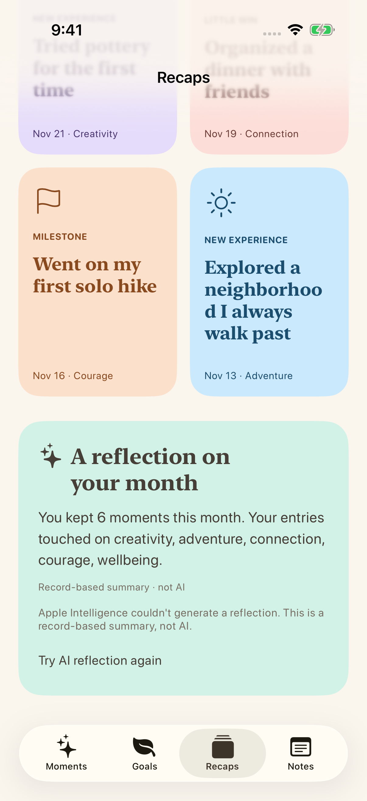
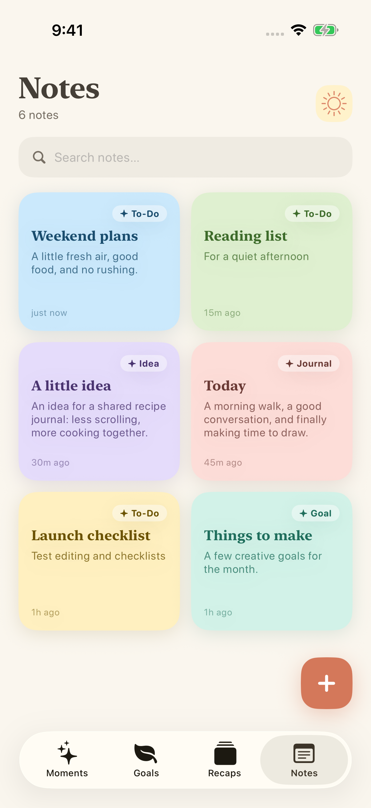
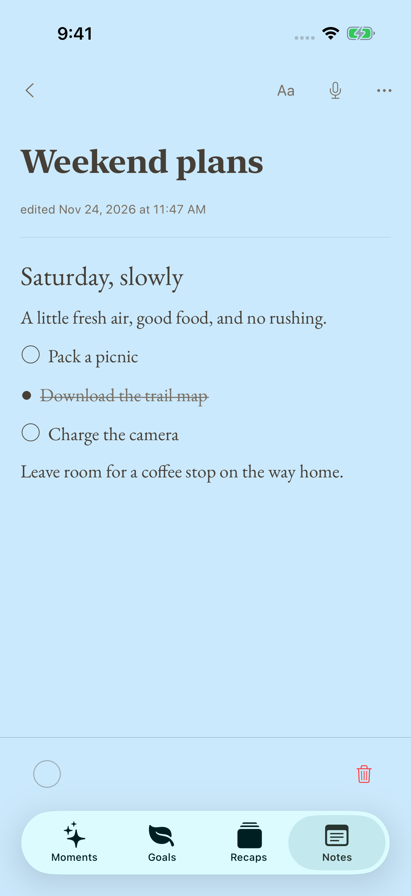

# Braindump

A place for thoughts, little wins, and things worth keeping.

Keep notes, record experiences, and look back on your month. **Little Wins**
is the moments feature inside Braindump: small things worth remembering,
firsts, and milestones. Personal goals connect those moments without
completion scores, streaks, or reminders about missed days.

Colorful pastel cards, bold serif headings, and a visual gallery make it
easy to look back. No streaks, completion scores, or catching up.

## Demo



[Watch the full walkthrough](docs/braindump-demo.mp4).

Recorded in the current app on an iPhone 17 simulator running iOS 26.5,
with illustrative entries in an isolated demo store. The short GIF shows
highlights; the video follows Moments, capture, Goals, Recaps, and the
notes editor, including page colors, search, and note details.
The reflection and note details show the real, labeled non-generative
fallback, not simulated AI output.

## The experience

- **Moments:** capture a sentence, a photo, or on-device voice transcription.
  Choose a little win, new experience, or milestone and backdate it if needed.
- **Goals:** make room for something meaningful and connect moments along the
  way. Progress is a story of small steps, not a completion percentage.
- **Monthly recaps:** a gallery of saved moments, category breakdowns, wins,
  experiences, milestones, and distinct days trying something new. Counts
  reflect recorded moments only, using when they happened rather than when
  they were edited.
- **Reflections:** optionally ask Apple's on-device model for themes supported
  by a sample of your written entries. Photos aren't analyzed. Unsupported
  devices or generation failures show an explicitly labeled record-based
  summary instead of presenting it as AI.
- **Notes:** keep free-form thoughts alongside moments, with a rich-text
  editor, checklists, page colors, search, and 30-day recovery. Existing
  notes remain notes; they aren't converted into wins.

Entries and selected photos live in the local SwiftData store. Photos are
resized before storage. Voice is transcribed, not saved as audio, and
dictation is unavailable rather than falling back to server transcription.
AI reflections are generated on demand; the recorded moments persist,
but generated reflection text is not saved between app launches.

## Preview

Simulator screenshots with illustrative entries. The reflection shows the
real, explicitly labeled offline fallback.

| Moments | Personal goals |
| --- | --- |
|  |  |

| Monthly recap | Reflection |
| --- | --- |
|  |  |

| Notes | Editor |
| --- | --- |
|  |  |

| Note details | Page colors |
| --- | --- |
|  |  |

## What uses AI?

AI is optional. On supported devices with Apple Intelligence enabled,
Apple's on-device Foundation Models can generate a monthly reflection,
summarize a note, suggest tags, and extract concrete to-dos from notes.
Growth entries don't get action-item suggestions.

Search also uses on-device sentence embeddings when available, alongside
literal text matches. Dictation uses on-device speech recognition. There
is no remote AI API or API key to configure.

If generative features aren't available or fail, note details disclose
their keyword/extractive fallback, and recaps label their record-based
summary as **not AI**. Capturing moments, linking goals, editing notes, and
viewing recaps don't require Apple Intelligence.

## Retained notes features

- Create, list, open/edit, and delete pages
- Change a page's pastel color
- Rich text: headings/subheading/body styles, bullets, checklists
- Character-level Bold/Italic/Underline formatting
- Soft-delete with a 30-day "recently deleted" recovery flow
- Home screen widget for quick access to a chosen page
- Dynamic Type layouts and VoiceOver labels

## Try it

Not on the App Store or TestFlight yet. Clone it and run it in Xcode
(iOS 17+, with iOS 26+ required for Apple's generative features).

For illustrative moments, a personal goal, and sample notes in a Debug build,
add `-SeedDemoData` to the scheme's
launch arguments. This only seeds an empty store and never replaces
existing notes.

The app and widget retain their original bundle identifiers and shared
App Group, so updating from the notes-only app preserves its store.

## Development checks

The shared scheme includes growth/recap tests for calendar boundaries,
local-day counts, deletion/restoration, persisted goal links and photos,
and migration from the original notes schema. UI workflows cover capture,
goal connections, recaps, offline AI disclosure, and the retained editor,
checklists, colors, save/relaunch persistence, deletion/undo, and search.
Each UI test uses its own Debug-only store and preserves it for relaunch
checks, rather than editing existing app data.

```sh
xcodegen generate
xcrun simctl addmedia 'iPhone 17' Braindump/Assets.xcassets/AppIcon.appiconset/icon-1024.png
xcodebuild -project Braindump.xcodeproj -scheme Braindump \
  -destination 'platform=iOS Simulator,name=iPhone 17' \
  CODE_SIGN_IDENTITY=- test
```

Boot the intended simulator before `addmedia`; the image is a fixture for
the real system photo-picker workflow. An unsigned iPhone Release archive
builds successfully. The growth screens and reflection flow also pass on
an iPhone 17 simulator in dark mode at accessibility-sized text.
Physical-device QA is still needed for live Apple
Intelligence and microphone dictation; simulator checks do not replace
signed distribution validation.

`BraindumpUITests/testDemoWalkthrough` exercises the current product tour
and attaches screenshots for Moments, capture, Goals, Recaps, reflections,
Notes, the editor, page colors, and note details. Use
`-only-testing:BraindumpUITests/BraindumpUITests/testDemoWalkthrough` to run
just that walkthrough.

## TestFlight

Distribution is pending Apple Developer signing and App Store Connect
setup; there is no uploaded beta build yet.

1. Confirm Apple Developer Program enrollment and sign in to Xcode.
2. Select the enrolled team for both the app and widget targets. Register
   their bundle identifiers and enable the shared App Group
   `group.com.athapar.braindump`.
3. Verify editing, the widget, voice permissions/dictation, and on-device
   AI on a physical iPhone.
4. Create the app in App Store Connect, archive a signed Release build,
   then validate and upload it from Xcode Organizer before inviting
   TestFlight testers.
